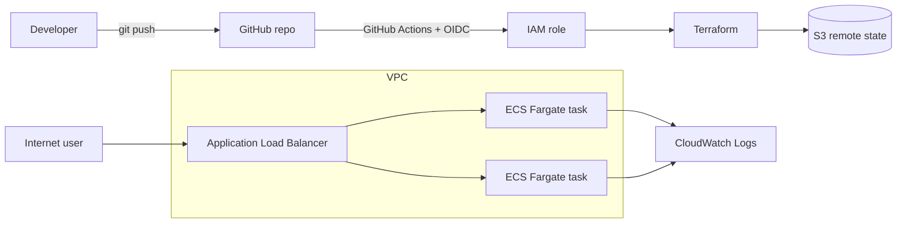
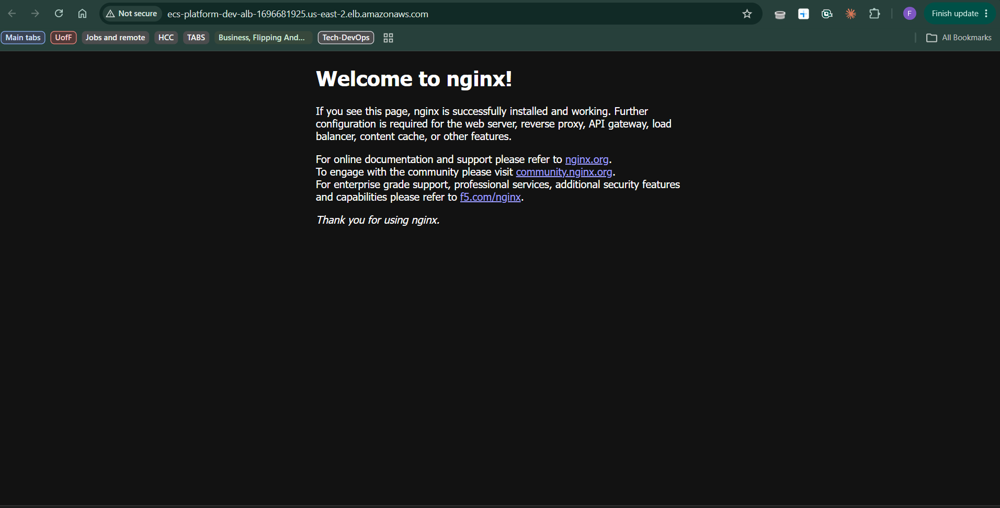

# AWS ECS Fargate Platform (Terraform)

A container platform on AWS defined entirely as code and deployed through GitHub Actions. The pipeline authenticates to AWS with OIDC, so there are no stored AWS keys.

## Architecture

## Repository layout

| Path | Purpose |
|---|---|
| `bootstrap/` | S3 state bucket (versioned, encrypted, public access blocked) and the GitHub OIDC provider and IAM role |
| `modules/vpc/` | VPC, 2 public and 2 private subnets across 2 AZs, internet gateway, optional NAT gateway |
| `modules/ecs/` | Application Load Balancer, ECS cluster, Fargate service, task definition, IAM execution role, CloudWatch log group |
| `environments/dev/` | Dev environment that wires the modules together and stores state in S3 |
| `.github/workflows/terraform.yml` | CI/CD pipeline |

## Pipeline

- Every pull request and push to `main` runs: format check, init, validate and plan.
- Apply and destroy are manual (workflow_dispatch) so merges never rebuild billable resources by accident.
- AWS access uses GitHub OIDC with a role limited to this repository.

## Usage

Create the remote state bucket and OIDC role once:

    cd bootstrap
    terraform init
    terraform apply

Then deploy the dev environment:

    cd environments/dev
    terraform init
    terraform apply

The `app_url` output is the load balancer address. Run `terraform destroy` in `environments/dev` when finished.

## Cost

The load balancer and two small Fargate tasks cost roughly $0.05 per hour while running. Destroy the dev environment after testing. The VPC, state bucket and IAM resources are effectively free.

## Security notes

- No static AWS credentials anywhere. The pipeline assumes a role through OIDC.
- The role trusts only this repository, using GitHub's immutable subject claim.
- State is encrypted, versioned and not publicly accessible, with S3 native locking.
- This lab role has AdministratorAccess for simplicity. A production setup should use a least-privilege policy.
- Tasks run in public subnets with public IPs to avoid NAT gateway cost. Production should use private subnets with a NAT gateway or VPC endpoints.

## Demo

The default nginx container served from ECS Fargate through the load balancer, deployed entirely with Terraform:

